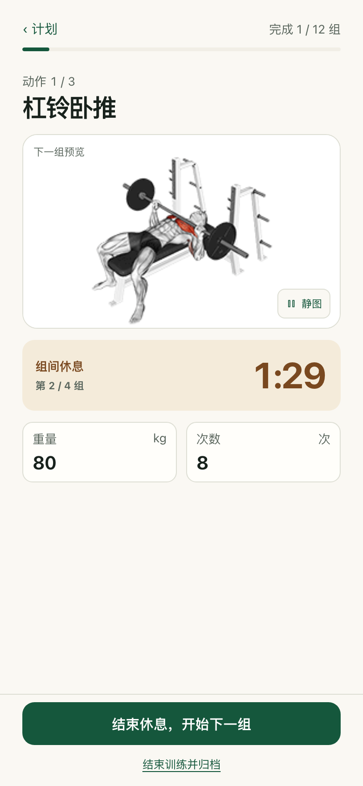

# FitCheck · 会说话、会记计划的健身 Agent

[](https://github.com/15016623369a-spe/bojililun/releases)
[](NOTICE.md)

一句话：**用嘴说今天练什么，它给你排计划；训练时一组一组点，自动计时和组间休息；练完自动进档案，统计和历史都在这。** 吃饭拍张照就完事。

当前是 Phase 1：**网页版三大主页（计划 / 记录 / 回顾）** + 语音对话 + 完整训练记录链路。不需要任何 API Key 就能跑，食物识别默认走演示模式。

---

## 三大主页 + 功能页

底部导航只有三个入口，其他页面都从它们进入：

| 主页 | 能干什么 |
| --- | --- |
| **计划**（`/body`） | **3D 人体**：点哪块肌肉出哪块肌肉的动作，一键加进今日清单；右上角进入今日训练清单（`/train`）和动作库 |
| **记录**（`/`） | 今天的时间线：训练、饮食、计划一屏看全；拍照 / 说话记饮食从这里进对话 |
| **回顾**（`/history`） | 日 / 周 / 月 journal、月历（`/history/calendar`）、每日详情（`/history/[date]`）、训练统计（`/stats`） |

| 功能页 | 能干什么 |
| --- | --- |
| 今日清单（`/train`） | 组数/次数/重量/休息可改、开始训练、今日热量与蛋白进度 |
| 训练执行（`/train/[id]`） | 进入即自动计时，「完成本组」记一组，组间休息倒计时 |
| 动作库（`/exercises`） | 1,324 个动作：部位 × 器械筛选 / 搜索 / 动图详情 |
| 对话（`/chat`） | 打字、按住麦克风说话，回复语音播报；排计划 / 记饮食 / 记忆管理 |
| 我的（`/me`） | 资料与目标推算、记忆管理、数据概览、模型状态 |

| 训练清单 | 训练执行 | 统计 |
| --- | --- | --- |
|  |  |  |

| 历史月历 | 动作库 | 对话 / 语音 |
| --- | --- | --- |
|  |  |  |

### 3D 人体（底部导航「计划」）

拖动旋转，点哪块肌肉就出哪块肌肉的动作。

| 3D 人体 | 点肌肉 → 动作弹层 | 转到背面 |
| --- | --- | --- |
|  |  |  |

- 模型：按性别加载 `public/models/porcelain/{sex}-fixed.glb`（瓷感外观）与 `public/models/athletes/{sex}/FitCheck-Muscles.glb`（肌肉解剖视图），CC0 授权（见 `public/models/athletes/LICENSE.md`）
- 直接在 3D 模型上点肌肉，可点 22 个肌肉区：胸（上/中/下/前锯肌）、肩（前中后束）、背（斜方/背阔/上背/下背）、手臂（二头/三头/前臂）、核心（腹直/腹斜）、腿（臀/股四头/腘绳/小腿/内收）、颈
- 支持深链 `/body?muscle=chest_upper` 直接打开某块肌肉
- 点选后整块肌肉组高亮，弹层给出该肌束的动作；动作归类在 `lib/muscles.ts`（按 target + 动作名关键词细分）
- 支持惯性拖动、缩放；未映射的小肌肉不可点

---

## 训练链路（核心）

```
动作库/3D 人体/对话 → 今日训练清单 → 开始训练（session）
   → 每个动作：进入即自动计时 → 完成本组（记重量×次数）→ 组间休息倒计时
   → 结束休息，开始下一组 / 下一动作 → 结束训练并归档
   → 跳回「记录」首页，历史 & 统计 自动汇总
```

- 组间休息默认 90s，可在清单里随时改成 60 / 90 / 120 / 180s
- 休息页可「结束休息，开始下一组」直接跳过倒计时
- 容量统一按 `重量 × 次数` 累加，自重动作按 0kg 计（只算组数和次数）
- 没练完就退出？训练页顶部会显示「有一节训练还没结束 · 继续训练」，计时进度存在 sessionStorage，刷新也能续练

对话里说 **「帮我安排今天练腿的动作，加进训练清单」**，它会按你记忆里的器械条件筛好动作、**并按伤病/禁忌记忆自动排除危险动作**（如肩伤排除过顶推举/抓举类），直接写进今日清单。

---

## 语音对话

- **语音输入**：Chrome / Safari 的 Web Speech API（`zh-CN`），说完自动发送
- **语音播报**：右上角「播报」开关控制，用系统 TTS 读回复
- 浏览器不支持时会给明确提示，打字照常可用

> 语音识别走浏览器自带的识别服务，不上传、不需要 Key。要更强的识别（口音、嘈杂环境），可以把 `/api/transcribe` 接上 Whisper 或国内 ASR。

---

## 快速开始

```bash
cd FitCheck
npm install
npm run dev
# 打开 https://127.0.0.1:3001 （「记录」首页，首次使用先填资料）
# 手机同一 Wi-Fi：https://<局域网IP>:3001 ，首次访问接受自签证书警告后即可用麦克风
```

`npm run dev` 默认走 **HTTPS**（自动生成含局域网 IP 的自签证书，`scripts/ensure-cert.mjs`），
因为浏览器只在 HTTPS / localhost 下开放麦克风——语音输入依赖它。纯 HTTP 调试用 `npm run dev:http`（手机语音不可用）。
首次启动自动建表、灌入 35 条食物和 1,324 个动作（`data/fitness.db`）。

### 接上真实模型

复制 `.env.example` 为 `.env.local`：

```bash
AI_PROVIDER=openai
AI_BASE_URL=https://api.openai.com/v1
AI_API_KEY=sk-...
AI_MODEL=gpt-4o-mini
```

通义（dashscope compatible-mode）、豆包（ark）、DeepSeek 等只要是 `/chat/completions` + `image_url` 格式都能用。接上后拍照才会真的识别；训练、统计、历史不依赖模型，一直是真的。

---

## 架构

```
app/
  page.tsx                 → / 「记录」今日时间线
  body/page.tsx            「计划」3D 人体（点肌肉看动作）
  train/page.tsx           今日训练清单 + 今日概况
  train/[id]/page.tsx      训练执行（自动计时 / 休息 / 记录）
  stats/page.tsx           统计（周月季年）
  history/page.tsx         「回顾」日/周/月 journal
  history/calendar/page.tsx 月历
  history/[date]/page.tsx  每日详情
  exercises/...            动作库 + 详情
  chat/page.tsx            对话（语音输入 + 播报）
  me/page.tsx              资料 / 记忆 / 数据
  api/exercises            按肌肉取动作（供 3D 人体用）
  api/plan                 今日清单增删改
  api/session, /session/set 训练会话与组记录
  api/chat, /meals, /memory, /today, /uploads, /gif
lib/
  core/workout.ts          清单、会话、统计、历史查询
  core/chat.ts             意图路由：排计划 / 训练建议 / 记饮食 / 记忆 + 约束安全过滤
  core/meals.ts            确认入库、今日快照
  core/enrich.ts           食物名+克数 → 营养
  core/journal.ts          记录/回顾时间线
  memory.ts                记忆读写 + 规则抽取
  exercise.ts              动作查询
  muscles.ts               细分肌肉 → 动作筛选 + 模型网格名匹配
  exercise-label.ts        部位 / 器械 / 肌肉中文标签
  period.ts                周月季年区间、月历
components/                BodyAtlas / AthleteViewer(3D 模型) / TrainingRunner / TodayPlan / JournalNav / ...
public/models/             porcelain + athletes 3D 模型（CC0）；旧版 body.glb（CC BY-SA，见 NOTICE）
public/draco/              DRACO 解码器（three.js 自带）
```

### 数据表

`profile` · `food_cache` · `meal_log` · `draft` · `memory` · `exercise`(1,324) · `plan_item` · `session` · `session_set`

### 四条设计原则

1. **AI 只做「非结构化 → 结构化」**，计算、筛选、计划全走确定性代码
2. **约束类记忆永远进上下文，且参与排计划的确定性过滤**：伤病/禁忌记忆会按关键词规则排除危险动作（宁可保守排除），不做检索裁剪（忘掉「左肩有伤」会让人受伤）
3. **记忆写入必须用户确认**，冲突不静默覆盖，可随时删除
4. **事件数据查库，不当记忆**：吃了什么、练了什么都在关系表里，SQL 比向量检索准

---

## 测试与截图

```bash
npm run dev                      # 另开一个终端

node scripts/smoke.mjs           # 饮食/记忆/训练建议 端到端冒烟
node scripts/shot.mjs            # 对话主流程截图（00–06）
node scripts/shot-library.mjs    # 动作库截图（07–10）
node scripts/shot-training.mjs   # 训练全链路截图（11–21）
node scripts/shot-body.mjs       # 3D 人体截图（22–24）

node scripts/translate-exercises.mjs   # 重新生成动作中文名（改词典后跑）
```

- 截图脚本自动寻找 chrome-headless-shell（项目 `../.playwright` 或系统 Playwright 缓存），也可用 `CHROMIUM_SHELL=/path/to/shell` 指定；没有时先 `npx playwright install chromium`
- `scripts/shot-training.mjs` 会用真实浏览器走完：清理残留会话 → 动作库加动作 → 改重量 → 开始训练 → 完成本组 → 休息倒计时 → 结束归档 → 历史 → 统计 → 我的 → 对话排计划，可重复运行

---

## 数据来源与许可

- **3D 人体模型**：当前使用 `public/models/porcelain/` 与 `public/models/athletes/`（CC0 1.0，见 `public/models/athletes/LICENSE.md`）。
  仓库仍保留旧版 `public/models/body.glb`，来自 [hpfrei/body-anatomy-3d-viewer](https://github.com/hpfrei/body-anatomy-3d-viewer)（CC BY-SA 4.0），
  其数据源自 [Z-Anatomy](https://www.z-anatomy.com/)（CC BY-SA 4.0，基于 BodyParts3D）。该文件及其衍生作品需沿用 CC BY-SA 4.0 并保留署名，详见 `NOTICE.md`。
- **动作数据集**：[hasaneyldrm/exercises-dataset](https://github.com/hasaneyldrm/exercises-dataset)，1,324 个动作，代码与数据 MIT。
  - 使用了元数据字段与 180×180 缩略图（`public/exercises/`，约 11MB）
  - **未打包 GIF**：详情页首次访问由 `/api/gif/[id]` 按需拉取并缓存到 `data/gifs/`，失败自动回落静态图
  - 媒体版权归 [Gym visual](https://gymvisual.com/)，按数据集授权在 180×180 分辨率下使用
  - **中文动作名**：数据集本身只有英文名，`scripts/translate-exercises.mjs` 用「短语优先 + 逐词兜底 + 人工修正表」把 1,324 个动作全部译成中文（覆盖率 100%），结果落在 `data/exercise-zh.json`，启动时同步进数据库 `zh_name` 列；界面以中文名为主，英文原名保留在详情页副标题
- **食物营养值**：常见食物近似值，仅供演示；正式产品建议接《中国食物成分表》或商业营养库

---

## 下一步

1. **渐进超负荷**：根据上次完成度自动建议下次重量（数据已够，缺算法与 UI）
2. **语音转写服务端化**：接 Whisper / 国内 ASR，解决浏览器支持面问题
3. **休息推荐**：按动作类型（复合/孤立）和组间目标心率给推荐值，而不是固定 90s
4. **微信客服适配层**：`core` 已与 channel 解耦，只差验签解密 + 消息收发
5. **睡眠录入 + 周报**

---

## 版本

当前版本 **v0.1.0**（2026-11-18），完整变更见 [CHANGELOG.md](CHANGELOG.md)，发布记录见 [Releases](https://github.com/15016623369a-spe/bojililun/releases)。