# FitCheck · 会说话、会记计划的健身 Agent

[](https://github.com/15016623369a-spe/bojililun/releases)
[](NOTICE.md)

一句话：**用嘴说今天练什么，它给你排计划；训练时一组一组点，自动计时和组间休息；练完自动进档案，统计和历史都在这。** 吃饭拍张照就完事。

当前是 Phase 1：**五模块网页版**（训练 / 统计 / 动作 / 历史 / 我的）+ 语音对话 + 完整训练记录链路。不需要任何 API Key 就能跑，食物识别默认走演示模式。

---

## 五个模块

| 模块 | 能干什么 |
| --- | --- |
| **训练** | 今日训练清单（组数/次数/重量/休息可改）、开始训练、今日热量与蛋白进度 |
| **统计** | 周 / 月 / 季 / 年：训练容量、次数、天数、时长、组数、肌群分布、容量趋势、动作表现 |
| **人体** | **真实解剖 3D 人体**（440 块肌肉网格，Z-Anatomy 数据）：胸分上/中/下、肩分前/中/后束，点哪块肌肉出哪块肌肉的动作，一键加进今日清单 |
| 动作库 | 完整列表：部位 × 器械筛选 / 搜索 / 动图详情（从「人体」页右上角或训练页进入） |
| **历史** | 月历 + 每日详情（训练每组记录、饮食、当日计划） |
| **我的** | 资料与目标推算、记忆管理、数据概览、模型状态 |

右下角绿色按钮进入**对话**：可以打字、可以**按住麦克风说话**，回复会语音播报。

| 训练清单 | 训练执行 | 统计 |
| --- | --- | --- |
| 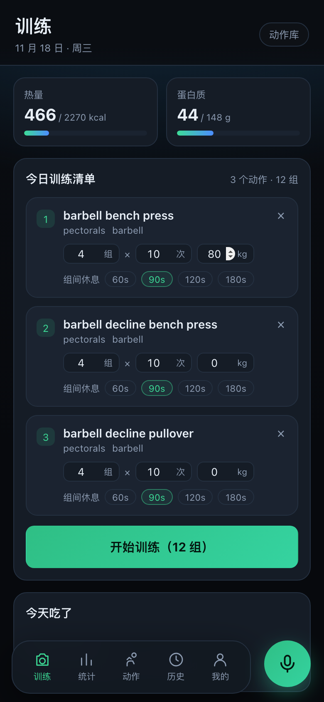 |  | 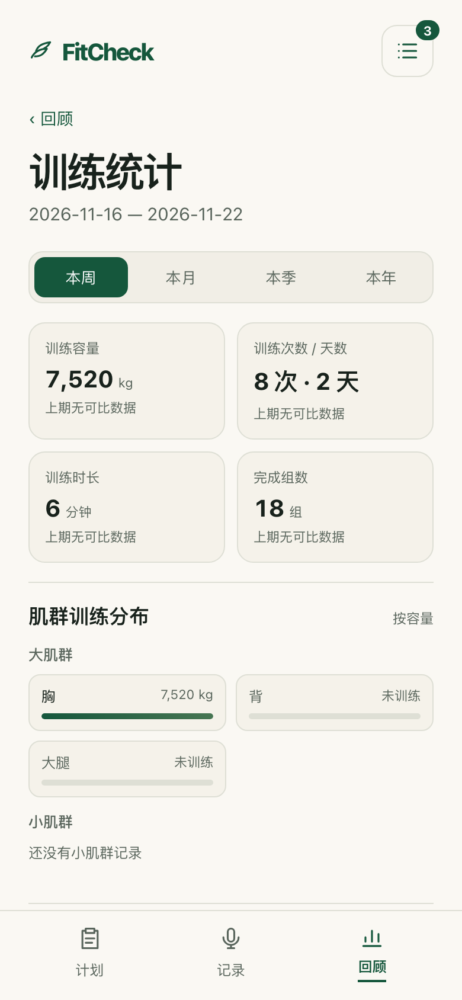 |

| 历史月历 | 动作库 | 对话 / 语音 |
| --- | --- | --- |
| 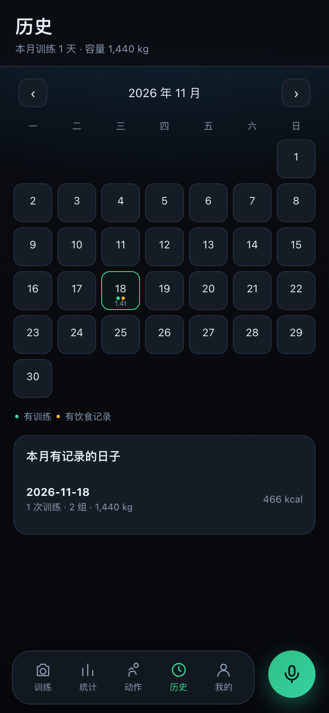 | 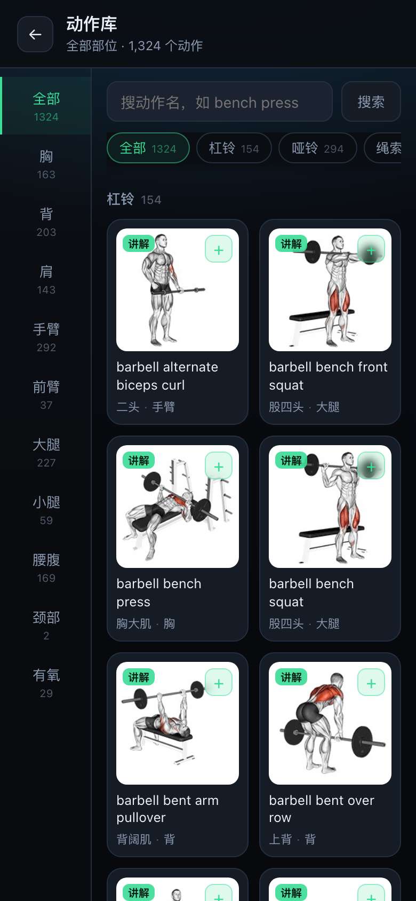 | 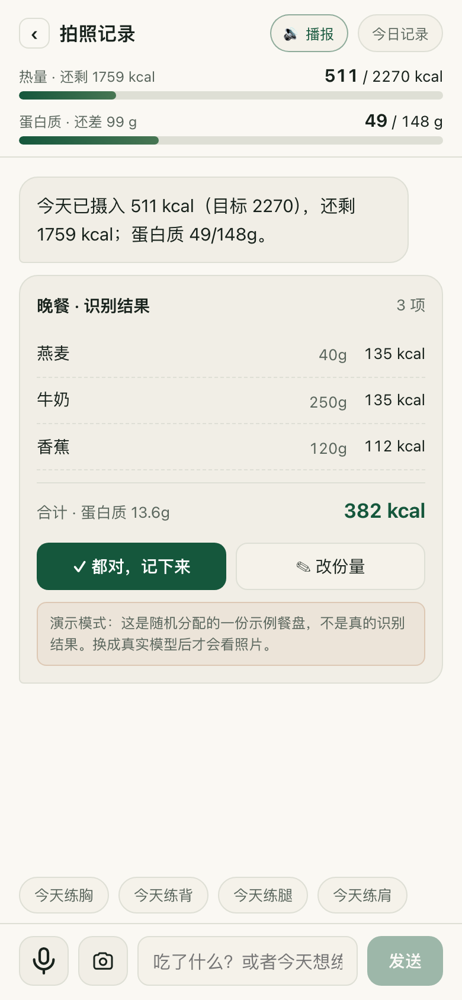 |

## 记录 / 回顾（浅色复刻版）

`/` 现在进的是浅色版界面，底栏三个 Tab（心智：**记 → 查 → 看**）：

| 页面 | 路由 | 能干什么 |
| --- | --- | --- |
| **记录** | `/log` | 今天的时间线（饮食 + 训练混排）、按住说话快记、记完的绿色卡片可「编辑 / 撤销」；只有这一页有 🎤 悬浮胶囊 |
| **身体** | `/atlas` | 全屏 3D 肌肉图（一屏从头顶到脚踝，默认全身），**今天练过的肌肉实时亮鼠尾草绿**；点任意肌肉 → 镜头平滑推近 → 该部位标准动作（可按器械筛选）→ GIF + 要点 → 一键「✓ 记入今天」，肌肉当场点亮 |
| **回顾** | `/review?period=day\|week\|month` | 日 / 周 / 月时间档案：本周概览（几天 / 几次 / 几餐 + 7 天圆点 + 部位标签）→ 按天的流水记录；不再放半屏大解剖图 |

- **语音**：走 Chrome / Safari 的 Web Speech API；不支持或没给麦克风权限时，短按按钮弹打字面板，走同一套解析
- **一句话 → 结构化**：`lib/parse-log.ts` 抽时长和条目（「20 分钟」「半小时」「一个半小时」），`lib/log.ts` 匹配动作库 / 食物库后落库
  （训练写 `session` + `session_set`，饮食写 `meal_log`），所以统计、历史跟手点出来的是同一份数据
- **接口**：`POST /api/log { text }` 快记、`PATCH /api/log` 编辑、`DELETE /api/log?kind=&id=` 撤销
- **演示数据 / 截图**：`node scripts/seed-demo.mjs --reset`、`node scripts/shot-replica.mjs`（产物在 `docs/replica/`）
- **一句话双路由**：陈述句与疑问句走两条完全不同的路
  - **陈述**（「中午吃了牛肉面加卤蛋」「刚做了高位下拉」）→ 静默秒记，不弹气泡、不留对话，直接把「已记录」卡片插进时间线
  - **疑问**（「牛肉面大概多少卡？」「高位下拉怎么发力？」「我这周练了哪几块？」）→ 底部升起临时问答浮层，
    `/api/ask` 用 SSE 流式吐字，答完给数据小卡 + 1~2 个一键胶囊（`+ 记入今天` / `✓ 练了这个`），向下划走即散
  - 意图判定在 `lib/intent.ts`（问号 + 疑问词，纯函数）；答案引擎在 `lib/ask.ts`，只答查得住的：
    食物热量查 `food_cache`、动作要点查数据集的 `zh_steps`、训练统计查 `session_set`、今日摄入查 `meal_log`
  - 胶囊会把答案里那套数字**一起带过去落库**（`POST /api/log { text, items }`），不会出现「答 275 kcal、记成 300 kcal」
- **记录面板（像笔记）**：长按大按钮直接说话；点一下打开面板，可以**打字 / 加照片 / 面板内再按住说话**（语音转写直接填进文本框）
  - 照片 + 训练文字 → 训练记录挂上这张图（`session.photo_path`）
  - 照片 + 饮食文字 / 没文字 → 走 `/api/chat` 的识图链路，先出「识别出这些，确认一下」草稿，确认后写 `meal_log`（`photo_path` 同样落库）
  - 照片会在时间线、已记录卡片、训练详情里显示缩略图/大图
- **动作字典**（`/atlas`）：解剖图就是索引 —— 点任意肌肉块（正面/背面可切），弹出这块肌肉的标准动作列表，
  按「经典动作优先 + 器械」排序；点动作看**动图 + 中文分步要点**（数据集 `zh_steps`），可一键加入今日训练
  - 支持深链 `/atlas?muscle=lats`；回顾页、训练详情里都有入口
  - 列表用静态缩略图（快），只有详情才加载 GIF（省流量）
- **训练详情**（`/log/training/<id>`）：点时间线上的训练就进去 —— 背面/正面 3D 解剖图按肌群努力量上色（热区 + 图例），
  下面给出这次训练的热量估算与拆解，再往下每个动作带动图、器械、组数 / 次数 / 重量，改完数字热区和热量立刻重算
- **热量口径**（`lib/energy.ts`，纯函数）：`kcal = MET × 3.5 × 体重 ÷ 200 × 时长 × 强度 × 器械系数`
  - MET 按部位（下肢 6 / 背 5.5 / 胸 5 / 肩 4.6 / 有氧 7.5）
  - 强度来自容量密度：`组数 × 次数 × 重量 ÷（时长 × 体重）`，映射到 0.9~1.5
  - 器械系数：杠铃 1.12 / 哑铃 1.06 / 绳索 1.00 / 固定器械 0.94 / 弹力带 0.90
  - 热区 = 每个动作的「组数 × 重量 × 次数」按主动发力 ×1、协同发力 ×0.4 摊到肌肉，再按最热的归一化
  - **输入有硬上限**：组数 1–20、次数 0–100、重量 0–500kg（`LIMITS`），前端输入即夹、API 落库再夹、计算层再夹；
    容量密度 > 8 kg/min/kg 会提示「数字偏大」；强度系数封顶 1.5，所以热量不会跟着错误容量线性涨
- 原来的五模块（训练 / 统计 / 人体 / 历史 / 我的）都还在原路由，回顾页底部有入口

| 记录 | 语音快记 | 回顾 |
| --- | --- | --- |
| 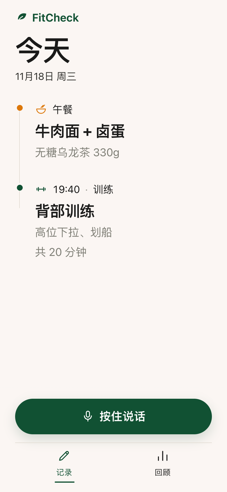 | 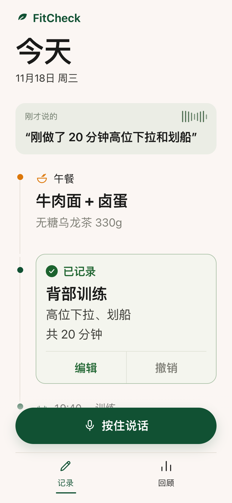 | 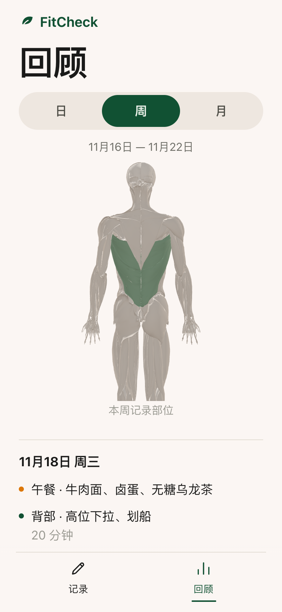 |

点开某次训练就是「解剖热区 + 热量估算 + 组数/重量编辑」：

| 训练详情（背面热区） | 动作与组数 |
| --- | --- |
| 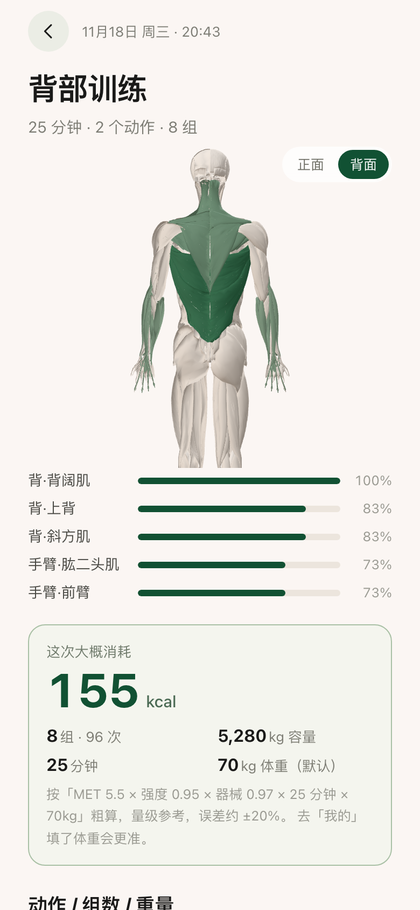 | 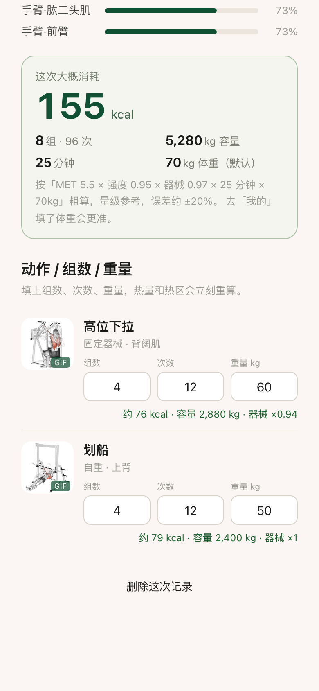 |

记录面板：文字 / 语音 / 照片都能来；带照片的训练记录：

| 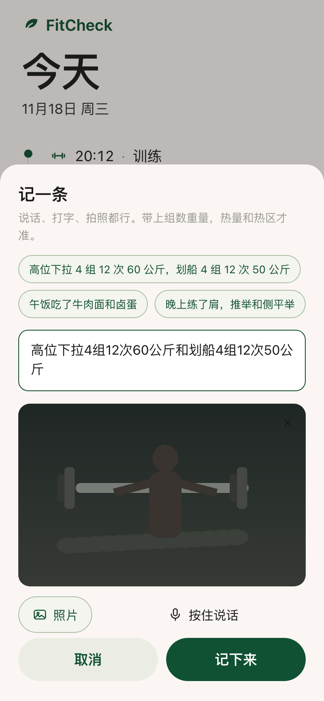 | 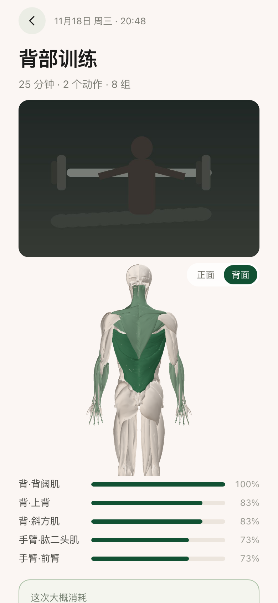 |

动作字典：点肌肉 → 标准动作 → 动图与要点：

| 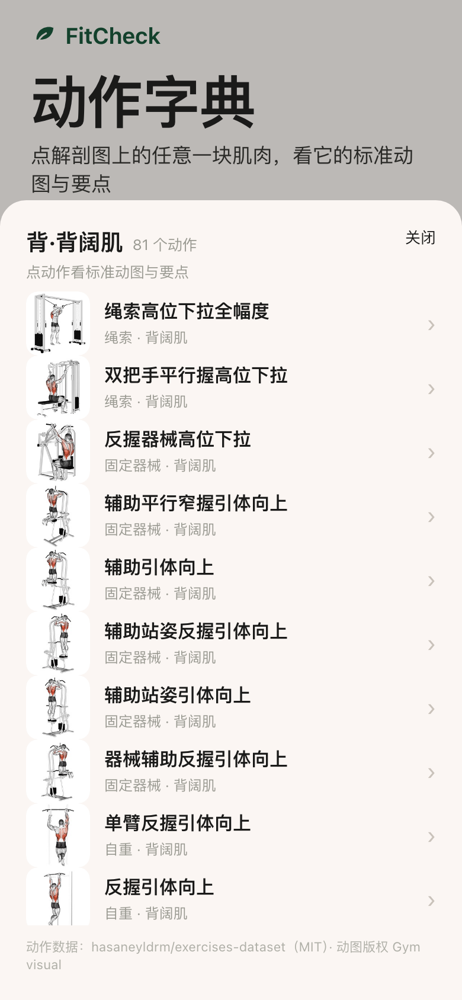 | 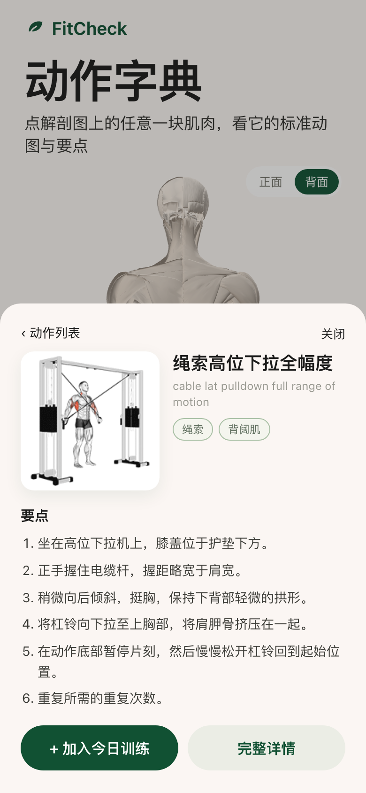 |

双路由：陈述直接出卡片（左），疑问升起临时浮层（右）：

| 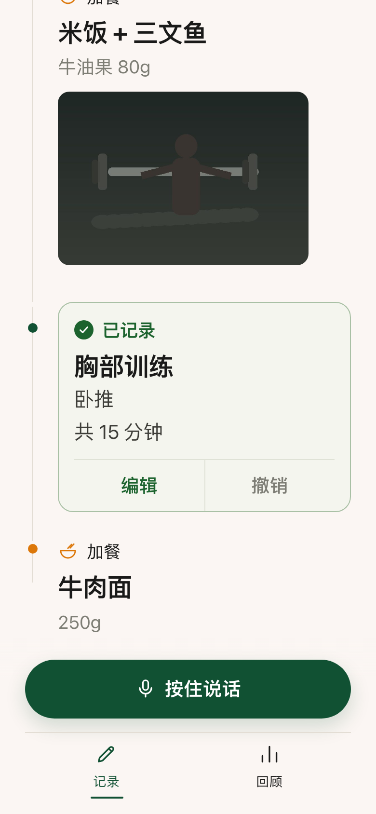 | 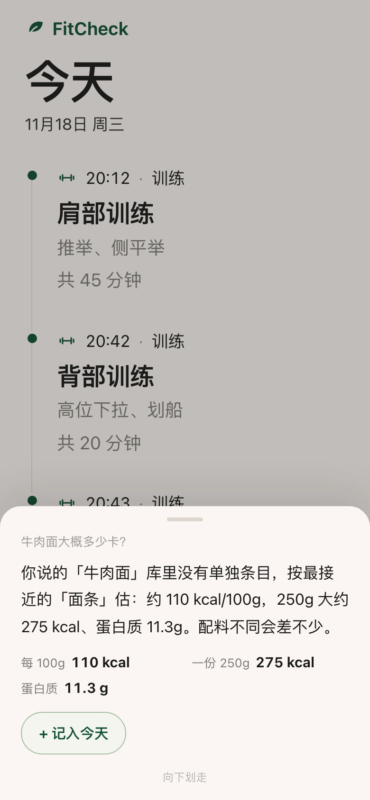 |

三 Tab：身体页（全屏解剖图 + 今日点亮）、回顾页（轻量档案本）：

| 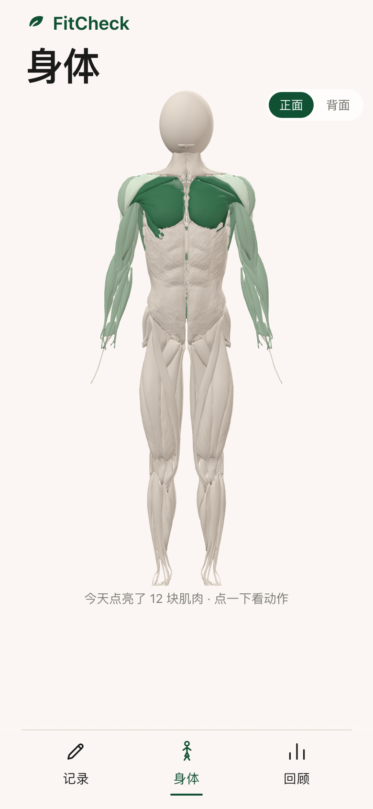 | 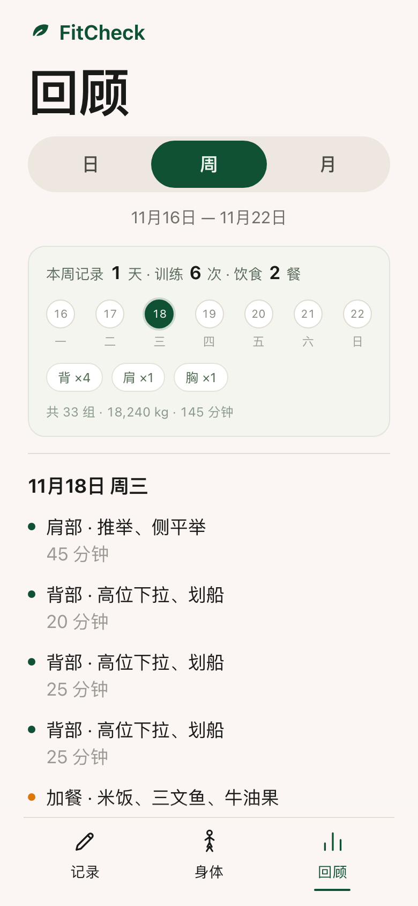 |

### 3D 人体（底部导航正中间）

拖动旋转，点哪块肌肉就出哪块肌肉的动作；也可以点下面的肌肉名切换。

| 3D 人体 | 点肌肉 → 动作弹层 | 转到背面 |
| --- | --- | --- |
| 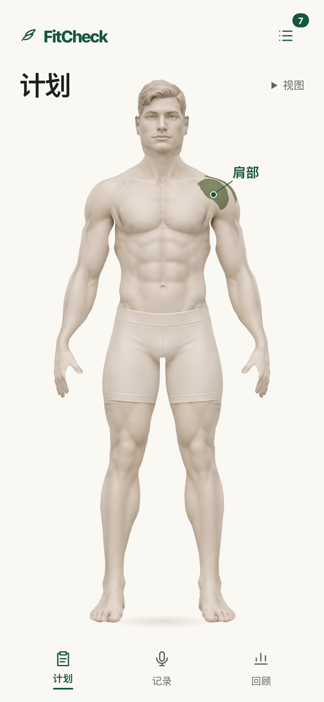 |  | 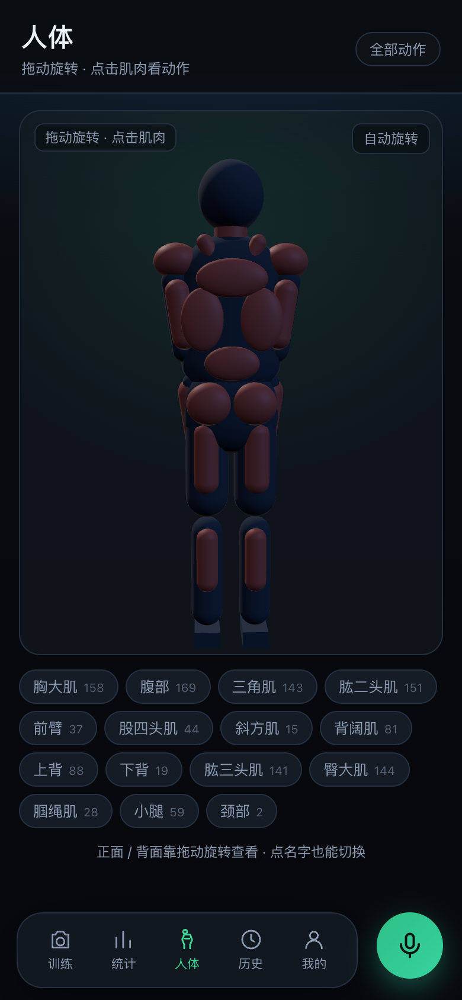 |

- 模型：Z-Anatomy 解剖数据导出的 `body.glb`（7.9MB，DRACO 压缩，440 块肌肉网格），按解剖学命名，
  例如 *Clavicular Head Of Pectoralis Major* = 上胸、*Sternocostal Head* = 中胸、*Abdominal Part* = 下胸
- 直接在 3D 模型上点肌肉（页面不再放肌肉列表，模型占满整屏）
- 可点 22 个肌肉区：胸（上/中/下/前锯肌）、肩（前中后束）、背（斜方/背阔/上背/下背）、
  手臂（二头/三头/前臂）、核心（腹直/腹斜）、腿（臀/股四头/腘绳/小腿/内收）、颈
- 支持深链 `/body?muscle=chest_upper` 直接打开某块肌肉
- 点选后整块肌肉组高亮，弹层给出该肌束的动作；动作归类在 `lib/muscles.ts`（按 target + 动作名关键词细分）
- 自动旋转可暂停，支持惯性拖动、缩放；未映射的小肌肉显示为暗红、不可点

---

## 训练链路（核心）

```
动作库/对话 → 今日训练清单 → 开始训练（session）
   → 每个动作：开始本组（计时）→ 结束本组（记重量×次数）→ 组间休息倒计时
   → 自动进入下一组 / 下一个动作 → 完成并保存
   → 历史 & 统计 自动汇总
```

- 组间休息默认 90s，可在清单里或训练中随时改成 60 / 90 / 120 / 180s
- 休息页有「+15s」「跳过休息」
- 容量统一按 `重量 × 次数` 累加，自重动作按 0kg 计（只算组数和次数）
- 没练完就退出？训练页顶部会显示「有一节训练还没结束 · 继续训练」

对话里说 **「帮我安排今天练腿的动作，加进训练清单」**，它会按你记忆里的器械条件筛好动作、直接写进今日清单。

---

## 语音对话

- **语音输入**：Chrome / Safari 的 Web Speech API（`zh-CN`），说完自动发送
- **语音播报**：右上角「播报」开关控制，用系统 TTS 读回复
- 浏览器不支持时会给明确提示，打字照常可用

> 语音识别走浏览器自带的识别服务，不上传、不需要 Key。要更强的识别（口音、嘈杂环境），可以把 `/api/transcribe` 接上 Whisper 或国内 ASR。

---

## 快速开始

```bash
cd fitness-agent
npm install
npm run dev
# 打开 http://127.0.0.1:3001 （会跳到 /log，按住说话就能记一条）
```

首次启动自动建表、灌入 35 条食物和 1,324 个动作（`data/fitness.db`）。

### 接上真实模型

复制 `.env.example` 为 `.env.local`：

```bash
AI_PROVIDER=openai
AI_BASE_URL=https://api.openai.com/v1
AI_API_KEY=sk-...
AI_MODEL=gpt-4o-mini
```

通义（dashscope compatible-mode）、豆包（ark）、DeepSeek 等只要是 `/chat/completions` + `image_url` 格式都能用。接上后拍照才会真的识别；训练、统计、历史不依赖模型，一直是真的。

---

## 架构

```
app/
  page.tsx                 → /train
  body/page.tsx            3D 人体（点肌肉看动作）
  train/page.tsx           今日训练清单 + 今日概况
  train/[id]/page.tsx      训练执行（计时 / 休息 / 记录）
  stats/page.tsx           统计（周月季年）
  history/page.tsx         月历
  history/[date]/page.tsx  每日详情
  exercises/...            动作库 + 详情
  chat/page.tsx            对话（语音输入 + 播报）
  me/page.tsx              资料 / 记忆 / 数据
  api/exercises            按肌肉取动作（供 3D 人体用）
  api/plan                 今日清单增删改
  api/session, /session/set 训练会话与组记录
  api/chat, /meals, /memory, /today, /uploads, /gif
lib/
  core/workout.ts          清单、会话、统计、历史查询
  core/chat.ts             意图路由：排计划 / 训练建议 / 记饮食 / 记忆
  core/meals.ts            确认入库、今日快照
  core/enrich.ts           食物名+克数 → 营养
  memory.ts                记忆读写 + 规则抽取
  exercise.ts              动作查询
  muscles.ts               细分肌肉 → 动作筛选 + 模型网格名匹配
  exercise-label.ts        部位 / 器械 / 肌肉中文标签
  period.ts                周月季年区间、月历
components/                BodyAtlas(GLTF 解剖模型) / TrainingRunner / TodayPlan / BottomNav / ...
public/models/body.glb     Z-Anatomy 解剖模型（CC BY-SA 4.0，见 NOTICE）
public/draco/              DRACO 解码器（three.js 自带）
```

### 数据表

`profile` · `food_cache` · `meal_log` · `draft` · `memory` · `exercise`(1,324) · `plan_item` · `session` · `session_set`

### 四条设计原则

1. **AI 只做「非结构化 → 结构化」**，计算、筛选、计划全走确定性代码
2. **约束类记忆永远进上下文**，不做检索裁剪（忘掉「左肩有伤」会让人受伤）
3. **记忆写入必须用户确认**，冲突不静默覆盖，可随时删除
4. **事件数据查库，不当记忆**：吃了什么、练了什么都在关系表里，SQL 比向量检索准

---

## 测试与截图

```bash
npm run dev                      # 另开一个终端

node scripts/smoke.mjs           # 饮食/记忆/训练建议 端到端冒烟
node scripts/shot.mjs            # 对话主流程截图（00–06）
node scripts/shot-library.mjs    # 动作库截图（07–10）
node scripts/shot-training.mjs   # 训练全链路截图（11–21）

node scripts/shot-body.mjs             # 3D 人体截图（22–24）
node scripts/translate-exercises.mjs   # 重新生成动作中文名（改词典后跑）
```

`scripts/shot-training.mjs` 会用真实浏览器走完：动作库加动作 → 改重量 → 开始训练 → 开始/结束本组 → 休息倒计时 → 结束训练 → 历史 → 统计 → 我的 → 对话排计划。

---

## 数据来源与许可

- **3D 人体模型**：`public/models/body.glb` 来自 [hpfrei/body-anatomy-3d-viewer](https://github.com/hpfrei/body-anatomy-3d-viewer)（CC BY-SA 4.0），
  其数据源自 [Z-Anatomy](https://www.z-anatomy.com/)（CC BY-SA 4.0，基于 BodyParts3D）。
  该模型文件及其衍生作品需沿用 CC BY-SA 4.0 并保留署名，详见 `NOTICE.md`。
- **动作数据集**：[hasaneyldrm/exercises-dataset](https://github.com/hasaneyldrm/exercises-dataset)，1,324 个动作，代码与数据 MIT。
  - 使用了元数据字段与 180×180 缩略图（`public/exercises/`，约 11MB）
  - **未打包 GIF**：详情页首次访问由 `/api/gif/[id]` 按需拉取并缓存到 `data/gifs/`，失败自动回落静态图
  - 媒体版权归 [Gym visual](https://gymvisual.com/)，按数据集授权在 180×180 分辨率下使用
  - **中文动作名**：数据集本身只有英文名，`scripts/translate-exercises.mjs` 用「短语优先 + 逐词兜底 + 人工修正表」把 1,324 个动作全部译成中文（覆盖率 100%），结果落在 `data/exercise-zh.json`，启动时同步进数据库 `zh_name` 列；界面以中文名为主，英文原名保留在详情页副标题
- **食物营养值**：常见食物近似值，仅供演示；正式产品建议接《中国食物成分表》或商业营养库

---

## 下一步

1. **渐进超负荷**：根据上次完成度自动建议下次重量（数据已够，缺算法与 UI）
2. **语音转写服务端化**：接 Whisper / 国内 ASR，解决浏览器支持面问题
3. **休息推荐**：按动作类型（复合/孤立）和组间目标心率给推荐值，而不是固定 90s
4. **微信客服适配层**：`core` 已与 channel 解耦，只差验签解密 + 消息收发
5. **睡眠录入 + 周报**

---

## 版本

当前版本 **v0.1.0**（2026-11-18），完整变更见 [CHANGELOG.md](CHANGELOG.md)，发布记录见 [Releases](https://github.com/15016623369a-spe/bojililun/releases)。
