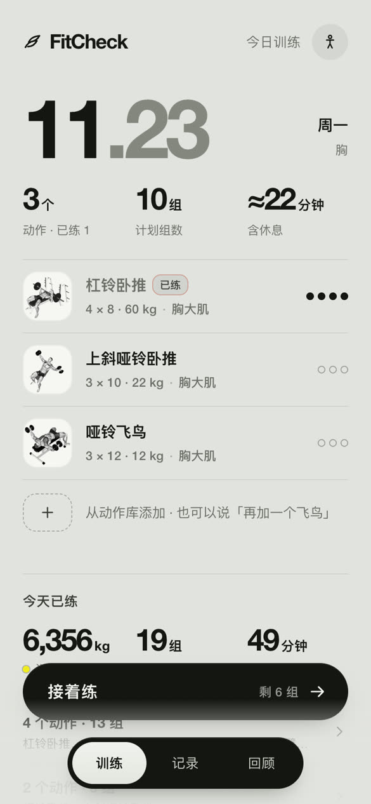
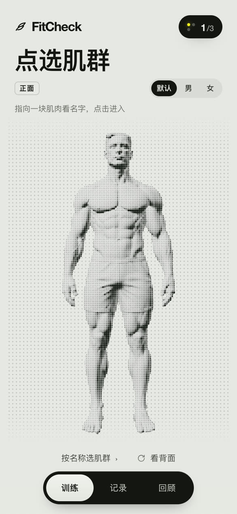
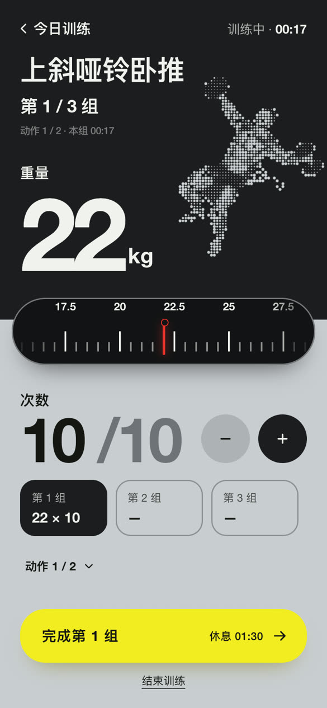
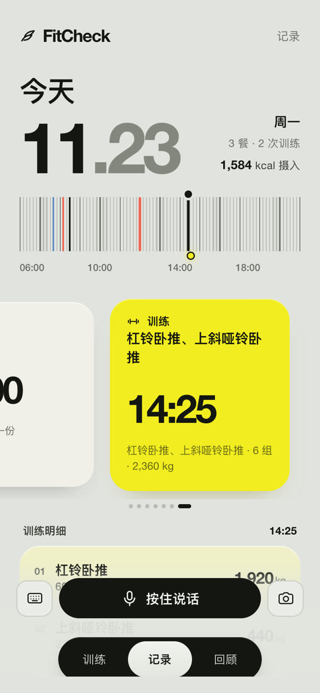
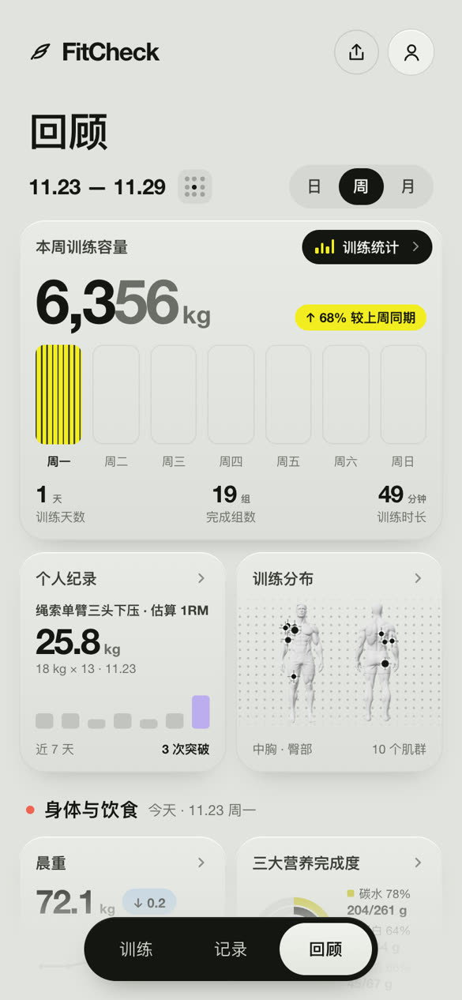
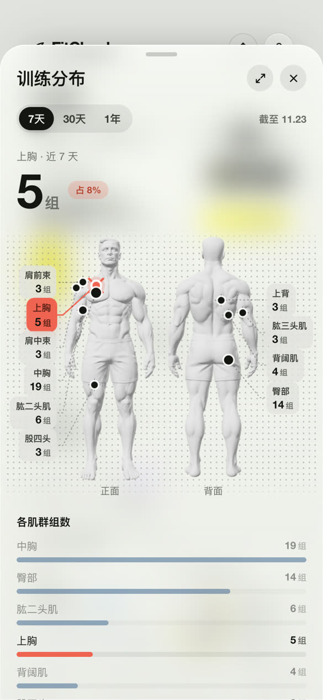
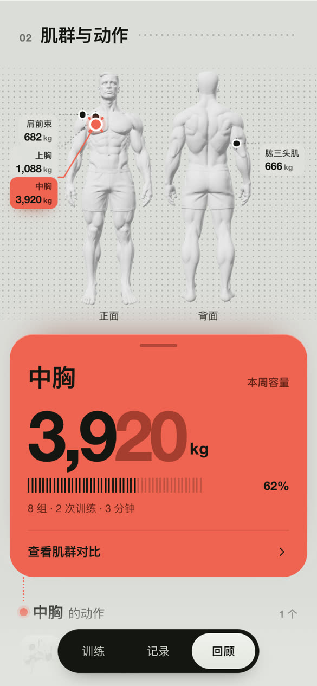
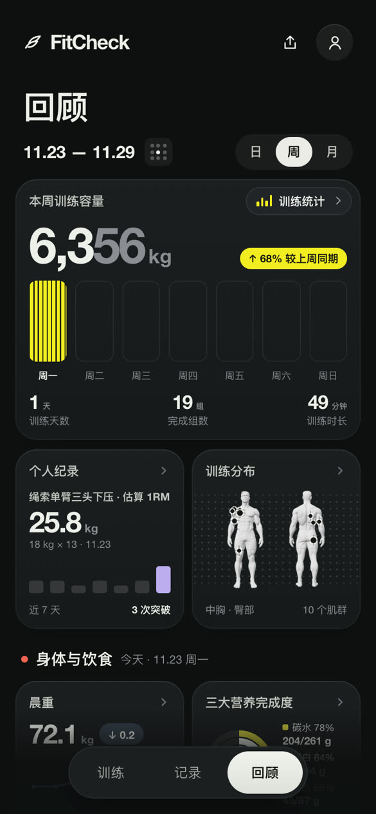
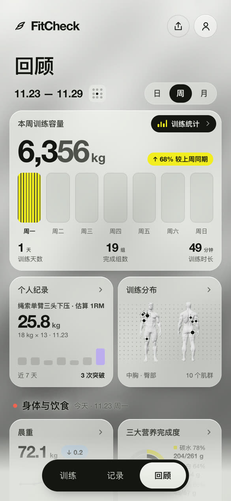

# FitCheck · 会说话、会记计划的健身手账

[](https://github.com/15016623369a-spe/bojililun/actions/workflows/ci.yml)
[](https://github.com/15016623369a-spe/bojililun/releases)
[](NOTICE.md)

以手机为主的中文健身记录应用，在自己电脑上就能部署。在人体上点选肌群安排今天的动作，或者按住「记录」说一句「今天练胸，给我排四个动作」；训练时逐组记录实际重量和次数，默认重量取上次，休息结束有提示音；说一句话、打字或拍张照记下训练、饮食和体重；回顾页一屏看完容量、个人纪录、训练分布、三大营养、热量缺口和代谢，训练统计再往下看肌群和动作表现。

不需要任何 API Key 就能跑：没接模型时，记录页用本地规则解析动作、组数、重量和食物份量，说话排计划也不需要模型；只有拍照识别饮食走演示模式。

---

## 界面一览

截图来自测试数据（一年的虚构记录），手机尺寸 390 × 844。

| 训练 | 点阵人体 | 训练中 |
| --- | --- | --- |
|  |  |  |

| 记录 | 回顾 | 回顾 · 训练分布抽屉 |
| --- | --- | --- |
|  |  |  |

| 训练统计 · 肌群与动作 | 夜间模式 | 自定义背景 |
| --- | --- | --- |
|  |  |  |

---

## 页面

底部导航是「训练 · 记录 · 回顾」三个入口，其他页面都从这里进入。

| 页面 | 能做什么 |
| --- | --- |
| **训练**（`/train`） | 今日训练单：动作、组次、重量和休息，排进计划的默认重量取这个动作上次实练的重量；按住「记录」说「今天练胸，给我排四个动作」「再加一个飞鸟」也能排计划（跳过不喜欢的动作和伤病限制要避开的动作）；开练、接着练、结束确认；今日营养与运动消耗估算 |
| 点阵人体（`/body`） | 从训练单「从动作库添加」进入：点阵人体拖动旋转，点选肌群推近到石膏姿势，毛玻璃抽屉里挑动作，选好回到训练单；「默认 / 男 / 女」模型切换 |
| 训练中（`/train/[id]`） | 逐组记录：刻度尺调重量、按钮调次数，下一组沿用上一组的重量，「完成第 N 组」；组间休息时屏幕常亮，结束响提示音并振动；可以换一个没练完的动作先练，刷新不丢输入 |
| 加练（`/train/extra`） | 计划练完后再加动作，流程同点阵人体 |
| **记录**（`/log`） | 大号日期、一天的条形码时间刻度、横向训练／饮食／体重卡片；长按「按住说话」就地录音，上滑取消，也可以打字或拍照；没接模型时按本地规则解析（动作名取最长匹配，词典外的动作照原话记，份量归给紧挨着的食物）；移除后可撤销 |
| **回顾**（`/review`） | 数据块墙：容量主块（日／周／月）＋ 个人纪录、训练分布、晨重、三大营养完成度、热量缺口、代谢、能量收支；点一块在原位展开毛玻璃抽屉，切 7 天／30 天／1 年，按住图表拖动读某一天 |
| 训练统计（`/stats`） | 周／月／季／年；总览（容量、运动时间），肌群与动作（解剖标注图，PR／8–12 RM／12–15 RM）。和回顾读同一份训练数据：训练页练的、语音和文字记的都算，每节只算一次 |
| 月历（`/history/calendar`） | 点某天用记录页的版式回看当天 |
| 我的（`/me`） | 训练目标、体重、伤病与限制、营养目标、动作偏好（`/me/exercises`）、显示模式（白天／夜间）、回顾与记录的背景图 |
| 建档（`/setup`） | 新用户一屏一问，共 7 步：人体模型、训练目标（必选）、体重、身高和年龄、活动量、伤病与限制、常练动作；其余都可跳过，填齐就直接算好热量目标和代谢 |
| 对话（`/chat`） | 打字或说话；拍照识别饮食（接上模型后生效，演示模式返回示例餐盘），结果卡可调份量 |
| 动作库（`/exercises`） | 1,324 个动作，部位 × 器械筛选、搜索、动图详情 |

完整的产品说明、每个页面的代码入口和统计口径见 [AGENTS.md](AGENTS.md)。

---

## 视觉与交互

- **冷银灰 + 墨黑**铺底，超大号等宽数字（末两位中灰、单位紧贴），条形码细柱、圆点阵和灰白石膏人体形成屏幕质感。
- **强调色各管一类数据**：柠檬黄（容量、主操作）、雾蓝（时长、体重）、珊瑚红（选中的肌群、语音、热量缺口）、淡紫（动作曲线、个人纪录），一屏只突出一个读数。
- **毛玻璃抽屉**：点开在原位长出来，背后页面只缩小、不压暗；下拉、点背后、返回键或 Esc 收起。
- **弹簧动效**：换页按导航方向滑入，选中胶囊弹到新位置，可点的控件按下收缩、松手回弹。
- **夜间模式**与**自定义背景**（回顾页透明度可调）在「我的」里设置。

设计资料：[视觉复刻规格](docs/design/2026-11-21/visual-handoff.md) · [回顾数据块墙交互原型](docs/design/2026-11-23/review-tiles-prototype.html) · [交互与视觉风格提示词](docs/design/fitcheck-design-prompts.md)

---

## 快速开始

```bash
npm install
npm run dev
# 打开 https://127.0.0.1:3001 ：新用户先建档，之后进入「记录」
# 手机同一 Wi-Fi：https://<局域网IP>:3001 ，首次访问接受自签证书警告后即可用麦克风
```

`npm run dev` 默认走 **HTTPS**（自动生成含局域网 IP 的自签证书，`scripts/ensure-cert.mjs`），因为浏览器只在 HTTPS / localhost 下开放麦克风。纯 HTTP 调试用 `npm run dev:http`（手机语音不可用）。

默认数据库是 `data/fitness.db`，首次启动自动建表并灌入动作库和食物数据。所有记录都在这一个文件里，上传的背景图在 `data/uploads/`；备份时停掉服务，复制这两样即可。截图或测试时可以用独立的测试库：

```bash
FITCHECK_DB_PATH=/tmp/fitcheck-demo.db npm run dev:http
```

### 接上真实模型

复制 `.env.example` 为 `.env.local`：

```bash
AI_PROVIDER=openai
AI_BASE_URL=https://api.openai.com/v1
AI_API_KEY=sk-...
AI_MODEL=gpt-4o-mini
DEEPSEEK_API_KEY=...        # 可选：语音意图分类，未配置时用本地规则
APP_TZ=Asia/Shanghai        # 服务端时区，影响「今天」和餐次
```

通义（dashscope compatible-mode）、豆包（ark）、DeepSeek 等只要是 `/chat/completions` + `image_url` 格式都能用。接上后拍照才会真的识别；训练、统计、回顾不依赖模型。

---

## 开发与检查

```bash
npm run typecheck                               # 类型检查
npm run test:ledger                             # 手账测试
node --test scripts/sculpture-labels.test.cjs   # 雕塑肌群标签测试
npm run build                                   # 生产构建
```

每个 PR 和推到 `main` 时，GitHub Actions（[ci.yml](.github/workflows/ci.yml)，Node 24）会依次跑这几步。提交 PR 的约定（改动前后对照截图、说明）见 [AGENTS.md](AGENTS.md) 的「提交 Pull Request」。

技术栈：Next.js 15 App Router、React 19、TypeScript、Three.js；服务端用 Node 的 `node:sqlite`。

```
app/            页面与接口（/train、/body、/log、/review、/stats、/me、/api/…），样式在 visual.css 与按页面拆分的 v-*.css
components/     review/（回顾数据块墙）、fc/（训练、计划、记录部件）、ui/（通用部件）、StatsBoard 等
lib/            ledger、export（手账）、review-wall（回顾数据与口径）、nutrition、core/（训练、饮食、档案、背景等）
public/models/  石膏雕塑、人体模型与正背面图
docs/           设计规格、交互原型、对话记录、PR 对照截图
```

### 设计原则

1. **AI 只做「非结构化 → 结构化」**，计算、筛选、计划全走确定性代码。
2. **约束类记忆永远进上下文，且参与排计划的确定性过滤**：伤病／禁忌会按规则排除危险动作，宁可保守。
3. **记忆写入必须用户确认**，冲突不静默覆盖，可随时删除。
4. **事件数据查库，不当记忆**：吃了什么、练了什么都在关系表里。
5. **每个数字说得清来历**：新指标都附「怎么算」，估算值标「约／估算」，没过完的今天标「截至现在」。
6. **训练数字只有一个来源**：回顾和训练统计都从手账读训练（`lib/training-log.ts`），训练页练的和语音、文字记的同样计入，不会两页对不上。
7. **宁可照原话记，也不记错**：本地解析认不准的动作按用户说的名字记，不套用相近的词典动作。

---

## 数据来源与许可

- **石膏雕塑模型**（`public/models/sculpture/`）：由 Tripo H3.1 从参考图生成，过程见 [docs/sculpture/BUILD.md](docs/sculpture/BUILD.md)。
- **人体模型**：`public/models/athletes/` 为 CC0 1.0（见其中的 `LICENSE.md`）。仓库保留的旧版 `public/models/body.glb` 及回顾正背面图层来自 [hpfrei/body-anatomy-3d-viewer](https://github.com/hpfrei/body-anatomy-3d-viewer)，数据源自 [Z-Anatomy](https://www.z-anatomy.com/)，均为 CC BY-SA 4.0，详见 [NOTICE.md](NOTICE.md)。
- **动作数据集**：[hasaneyldrm/exercises-dataset](https://github.com/hasaneyldrm/exercises-dataset)，1,324 个动作，代码与数据 MIT；180×180 缩略图打包在 `public/exercises/`，GIF 由 `/api/gif/[id]` 按需拉取缓存；媒体版权归 [Gym visual](https://gymvisual.com/)。中文动作名由 `scripts/translate-exercises.mjs` 生成。
- **食物营养值**：常见食物近似值，仅供演示。

---

## 接下来

1. 训练页「今天已练」和记录页顶部的「n 次训练」接上回顾、统计用的同一份训练数据。
2. 自定义背景图文件丢失时回退到默认冷银灰。
3. 训练档案和营养资料合并成一份。
4. 在 iPhone 真机上验收毛玻璃、抽屉手势、滚动、休息提示音和屏幕常亮。
5. 回顾页按需加载抽屉数据，减少首屏计算。
6. 渐进超负荷：根据上次完成度建议下次重量。
7. 语音转写服务端化（Whisper 或国内 ASR）。

---

## 版本

首个版本 **v0.1.0**（2026-11-18），之后的新版视觉、回顾数据块墙和自定义背景见 [CHANGELOG.md](CHANGELOG.md) 与合并记录；发布记录见 [Releases](https://github.com/15016623369a-spe/bojililun/releases)。

11 月 23 日合入：回顾与训练统计共用一份训练数据（[#24](https://github.com/15016623369a-spe/bojililun/pull/24)）、本地解析不再记错动作和份量（[#25](https://github.com/15016623369a-spe/bojililun/pull/25)）、说话排计划与建档补齐营养资料（[#26](https://github.com/15016623369a-spe/bojililun/pull/26)）、训练页休息提醒和默认重量（[#27](https://github.com/15016623369a-spe/bojililun/pull/27)）。
